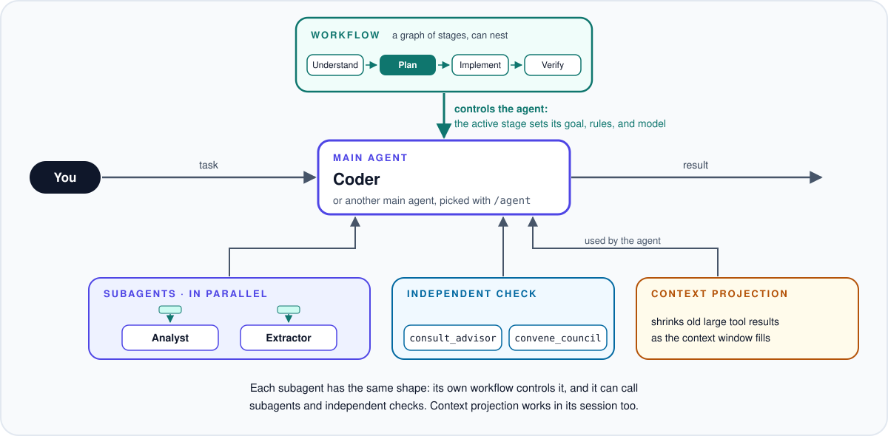
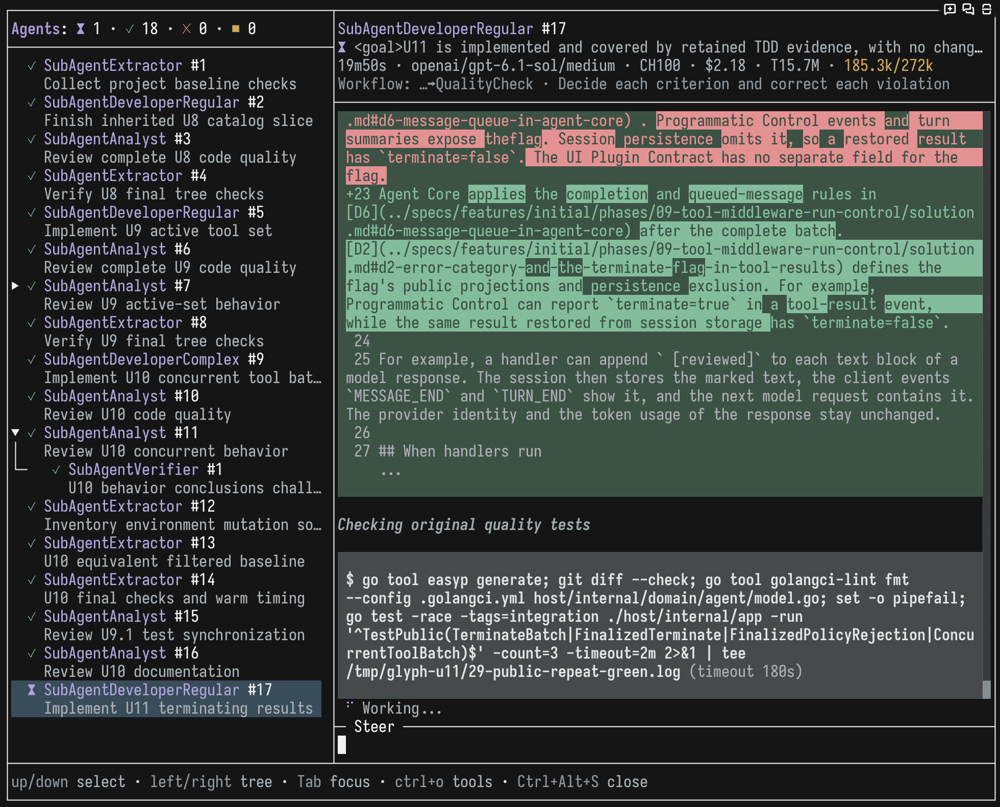
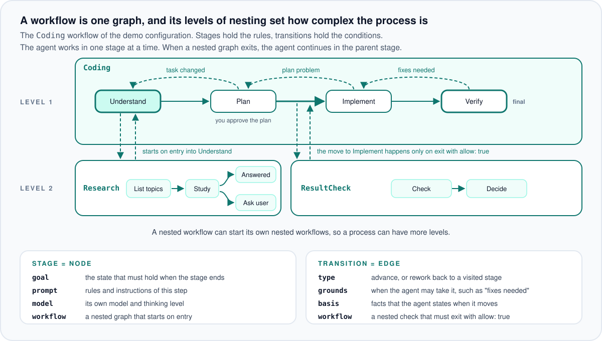
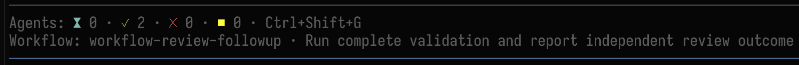
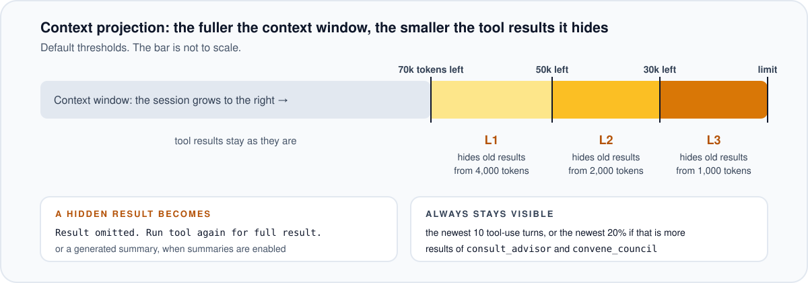
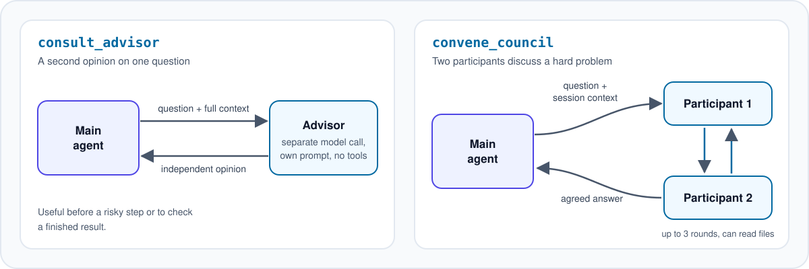

# Pi Agent Suite

Extensions for the [Pi coding agent](https://pi.dev/) that turn one agent into a team. A workflow controls each agent stage by stage, the main agent delegates work to subagents, any agent can ask for an independent check of its work, and context projection keeps long sessions inside the context window.



**Supported Pi version: 1.5.0** · [Quick start](#quick-start) · [All extensions](#all-extensions)

## What you get

### Agents for different jobs

Each agent is a Markdown file with its own prompt, model, thinking level, allowed tools, subagents, and workflows. You switch the main agent with `/agent` or `Ctrl+Alt+A`.

The main agent starts subagents in the background and can run several of them at once. Each subagent has its own model, tools, and workflows, and it can start subagents of its own: `maxDepth` in `run-subagent/config.json` sets how deep delegation goes. Its default value 1 lets only the main agent start subagents, and the demo configuration sets 2. Open `/subagents` or press `Ctrl+Alt+S` to watch each subagent, read its output, and send it a message.



Details: [agent selection](https://github.com/n-r-w/pi-agent-suite/blob/main/docs/extensions/main-agent-selection.md), [subagents](https://github.com/n-r-w/pi-agent-suite/blob/main/docs/extensions/run-subagent.md).

### Workflows: the process as one graph

A long multi-step prompt lets the model skip steps and forget rules. A workflow controls the agent that runs it, in the main session and in each subagent, and describes its process as a graph. Each node is a stage: it holds the rules of the step and the goal that must hold at its end, and it can set its own model and thinking level. Each edge is a transition: forward to the next stage, or back to a visited stage for rework, with the conditions under which the agent may take it. The workflow prompt holds the rules that apply in every stage. The agent works in one stage at a time and moves only along an edge, and for each move it states the facts that justify it.

Any node or edge can open a nested graph, so the number of nesting levels sets how complex the process is. A stage can name a workflow that starts on each entry into the stage. A transition can name a check workflow, and the move happens only when the check exits with `allow: true`. The agent also starts a nested workflow on its own when the description of that workflow fits the current work. While a nested workflow runs, its parent waits at its stage, and the agent continues there after the nested workflow exits.



The session status panel shows the subagent counters and the active workflow stage:



Details: [workflow format, nesting, and tools](https://github.com/n-r-w/pi-agent-suite/blob/main/docs/extensions/workflow.md).

### Long sessions without context overflow

When the context window fills up, `context-projection` replaces old large tool results with a short notice or a generated summary. The closer the session gets to the limit, the smaller the results that it replaces. The newest turns stay intact, so the model keeps the details of its current step. To read a replaced result again, the model runs the tool again. Projection works in the main session and in each subagent session.



Details: [context projection](https://github.com/n-r-w/pi-agent-suite/blob/main/docs/extensions/context-projection.md), [custom compaction](https://github.com/n-r-w/pi-agent-suite/blob/main/docs/extensions/custom-compaction.md).

### An independent check of the work

A model tends to trust its own conclusions. `consult_advisor` sends a question with the full current context to a separate model call that has its own prompt and no tools. `convene_council` gives a hard question to two participants: they can read files, discuss for up to 3 rounds, and return an agreed answer or report that they did not agree. The main agent and each subagent can call both tools when its `tools` list allows them.



Details: [advisor](https://github.com/n-r-w/pi-agent-suite/blob/main/docs/extensions/consult-advisor.md), [council](https://github.com/n-r-w/pi-agent-suite/blob/main/docs/extensions/convene-council.md).

### Also included

- Project rules from `.pi/rules` and project knowledge that persists across sessions.
- `/usage` with cache and estimated-cost statistics per agent and model.
- `/prompt` for building a structured request, and `/ask` for a one-off question that stays out of the session.
- Model aliases that every model setting of the suite accepts.

See [all extensions](#all-extensions).

## Quick start

### Before you start

1. Install Pi: `curl -fsSL https://pi.dev/install.sh | sh`. Other ways to install are on [pi.dev](https://pi.dev/).
2. Start `pi` and run `/login` to connect a model provider.

### 1. Install the package

```bash
pi install npm:pi-agent-suite
```

Most extensions work right after installation. Agents and workflows need definition files, which the next step adds.

### 2. Copy the demo configuration

The demo configuration contains three agents and five workflows. The agents use the model that is selected in Pi.

```bash
mkdir -p ~/.pi/agent/agent-suite
curl -fsSL https://github.com/n-r-w/pi-agent-suite/archive/refs/heads/main.zip \
  | bsdtar -xf- --strip-components=4 -C ~/.pi/agent/agent-suite \
    pi-agent-suite-main/docs/examples/agent-suite
```

The command needs `bsdtar`. macOS has it; on Debian or Ubuntu, install the `libarchive-tools` package. The command overwrites files with the same names in `~/.pi/agent/agent-suite`. You can also copy the [demo folder](https://github.com/n-r-w/pi-agent-suite/tree/main/docs/examples/agent-suite) by hand.

After the copy, `~/.pi/agent/agent-suite` contains:

```text
agent-selection/
  config.json
  agents/
    Coder.md           main agent for coding tasks
    Analyst.md         subagent for reviews, research, designs, and plans
    Extractor.md       subagent that collects facts from sources
run-subagent/
  config.json          maxDepth 2: a subagent can start its own subagents
workflow/
  workflows/
    Coding.yaml        coding task in four stages: understand, plan, implement, verify
    Research.yaml      nested: collects facts, starts on entry into the first stage of Coding
    ResultCheck.yaml   nested: checks the plan before the move to implementation
    Analysis.yaml      analysis task of the Analyst subagent
    Extraction.yaml    fact collection of the Extractor subagent
```

### 3. Select the agent

1. Start `pi` in a project directory.
2. Run `/agent` or press `Ctrl+Alt+A`, and select `Coder`.

### 4. Try it

1. Ask: `What subagents, advisors, and workflows are available? Give a very brief summary.` The agent names `Analyst`, `Extractor`, `consult_advisor`, and the `Coding` and `Research` workflows.
2. Ask: `Try running each subagent to see how it works.` Then open `/subagents` or press `Ctrl+Alt+S` to watch both subagents work in parallel.
3. Give the agent a coding task and name the workflow, for example `Use the Coding workflow: add a function subtract(a, b) to calc.py and a test for it.` Without the name, the agent may create a smaller workflow of its own for a simple task. The `Coding` workflow starts `Research` in its first stage, and the status panel shows the chain as `Workflow: Coding➡Research · <current stage>`. The agent then shows a short plan and waits for your approval. Before it changes code, `ResultCheck` checks the plan, and the move to implementation happens only when the check passes. In the last stage, `Analyst` reviews the change, and the agent gives you the final report.

## Turn on more features

These extensions are off by default. Each one reads its settings from `~/.pi/agent/agent-suite/<extension>/config.json`.

### Context projection

Create `~/.pi/agent/agent-suite/context-projection/config.json`:

```json
{
  "enabled": true
}
```

Context projection requires custom compaction, which is on by default. Thresholds, protected turns, and generated summaries are described in the [context projection documentation](https://github.com/n-r-w/pi-agent-suite/blob/main/docs/extensions/context-projection.md).

### Model council

1. Create `~/.pi/agent/agent-suite/convene-council/config.json`:

   ```json
   {
     "enabled": true
   }
   ```

2. Add `convene_council` to the `tools` list of each agent that may call the council, for example in `agent-selection/agents/Coder.md`.

Both participants use the current model by default. To compare two different models, set a model for each participant: see the [council documentation](https://github.com/n-r-w/pi-agent-suite/blob/main/docs/extensions/convene-council.md).

## All extensions

| Extension | Default | What it does |
| --- | --- | --- |
| [`main-agent-selection`](https://github.com/n-r-w/pi-agent-suite/blob/main/docs/extensions/main-agent-selection.md) | Enabled | Adds `/agent` and `Ctrl+Alt+A` for selecting a main agent. |
| [`run-subagent`](https://github.com/n-r-w/pi-agent-suite/blob/main/docs/extensions/run-subagent.md) | Enabled | Lets agents start, steer, wait for, and query subagents; adds the `/subagents` (`Ctrl+Alt+S`) screen. |
| [`workflow`](https://github.com/n-r-w/pi-agent-suite/blob/main/docs/extensions/workflow.md) | Inactive until configured | Runs staged workflows from `.yaml` files in `workflow/workflows`. |
| [`consult-advisor`](https://github.com/n-r-w/pi-agent-suite/blob/main/docs/extensions/consult-advisor.md) | Enabled | Adds the `consult_advisor` tool for an independent model opinion. |
| [`convene-council`](https://github.com/n-r-w/pi-agent-suite/blob/main/docs/extensions/convene-council.md) | Disabled | Adds the `convene_council` tool for a discussion of two participants. |
| [`context-projection`](https://github.com/n-r-w/pi-agent-suite/blob/main/docs/extensions/context-projection.md) | Disabled | Replaces old large tool results with a notice or a summary as the context fills up. |
| [`custom-compaction`](https://github.com/n-r-w/pi-agent-suite/blob/main/docs/extensions/custom-compaction.md) | Enabled | Replaces Pi compaction with adaptive summarization of the session history. |
| [`compaction-trigger`](https://github.com/n-r-w/pi-agent-suite/blob/main/docs/extensions/compaction-trigger.md) | Enabled | Runs compaction at Pi's compaction threshold and then continues the interrupted run. |
| [`skill-restoration`](https://github.com/n-r-w/pi-agent-suite/blob/main/docs/extensions/skill-restoration.md) | Enabled | After compaction, restores the skill files that the session loaded. |
| [`knowledge`](https://github.com/n-r-w/pi-agent-suite/blob/main/docs/extensions/knowledge.md) | Enabled | Keeps global and branch-local project knowledge across sessions. |
| [`project-rules`](https://github.com/n-r-w/pi-agent-suite/blob/main/docs/extensions/project-rules.md) | Enabled | Adds Markdown rules from the `.pi/rules` folder of the project. |
| [`system-prompt`](https://github.com/n-r-w/pi-agent-suite/blob/main/docs/extensions/system-prompt.md) | Enabled | Replaces Pi's base system prompt with a Markdown template. |
| [`model-aliases`](https://github.com/n-r-w/pi-agent-suite/blob/main/docs/extensions/model-aliases.md) | Optional config | Defines model aliases that every model setting of the suite accepts. |
| [`mcp-wrapper`](https://github.com/n-r-w/pi-agent-suite/blob/main/docs/extensions/mcp-wrapper.md) | No MCP tools until configured | Registers tools of MCP servers; a server can stay hidden until the model opens its toolset, and the agent gets only its allowed tools. |
| [`enable-tools`](https://github.com/n-r-w/pi-agent-suite/blob/main/docs/extensions/enable-tools.md) | Enabled | Enables built-in tools such as `grep`, `find`, and `ls`. |
| [`structured-prompt`](https://github.com/n-r-w/pi-agent-suite/blob/main/docs/extensions/structured-prompt.md) | Enabled | Adds `/prompt` and `Ctrl+Alt+P` for building a structured request. |
| [`ask-llm`](https://github.com/n-r-w/pi-agent-suite/blob/main/docs/extensions/ask-llm.md) | Enabled | Adds `/ask` for a one-off question that is not saved to the session. |
| [`usage`](https://github.com/n-r-w/pi-agent-suite/blob/main/docs/extensions/usage.md) | Enabled | Records model usage and adds `/usage` with statistics per agent, model, and cache. |
| [`algorithms`](https://github.com/n-r-w/pi-agent-suite/blob/main/docs/extensions/algorithms.md) | Enabled | Runs registered algorithms with `--trigger <type>` and `/trigger:<type>`. |
| [`footer`](https://github.com/n-r-w/pi-agent-suite/blob/main/docs/extensions/footer.md) | Enabled | Shows the project, git branch, model, and statuses of other extensions. |
| [`model-response-timeout`](https://github.com/n-r-w/pi-agent-suite/blob/main/docs/extensions/model-response-timeout.md) | Enabled | Limits the time of each model response and leaves the retry to Pi. |
| [`openai-websocket`](https://github.com/n-r-w/pi-agent-suite/blob/main/docs/extensions/openai-websocket.md) | Enabled | Sends requests of the `openai` provider over one WebSocket connection per session. |
| [`vision`](https://github.com/n-r-w/pi-agent-suite/blob/main/docs/extensions/vision.md) | Disabled | Adds `describe_image`, so a text-only model can ask a vision model about an image. |
| [`remote-image`](https://github.com/n-r-w/pi-agent-suite/blob/main/docs/extensions/remote-image.md) | Disabled | Pastes a local clipboard image into Pi running on a remote server over SSH. |
| [`codex-fast`](https://github.com/n-r-w/pi-agent-suite/blob/main/docs/extensions/codex-fast.md) | Disabled | Toggles fast mode for OpenAI Codex with `/fast` or `Ctrl+Alt+F`. |
| [`codex-verbosity`](https://github.com/n-r-w/pi-agent-suite/blob/main/docs/extensions/codex-verbosity.md) | Disabled | Sets the verbosity of OpenAI Codex responses. |
| [`codex-quota`](https://github.com/n-r-w/pi-agent-suite/blob/main/docs/extensions/codex-quota.md) | Disabled | Shows the OpenAI Codex quota in the footer. |
| [`completion-sound`](https://github.com/n-r-w/pi-agent-suite/blob/main/docs/extensions/completion-sound.md) | Enabled | Plays a sound when a top-level agent run succeeds. |
| [`cmux`](https://github.com/n-r-w/pi-agent-suite/blob/main/docs/extensions/cmux.md) | Enabled | Sends a [cmux](https://cmux.com/) notification when a top-level agent run succeeds. |

## License

[MIT](https://github.com/n-r-w/pi-agent-suite/blob/main/LICENSE)
