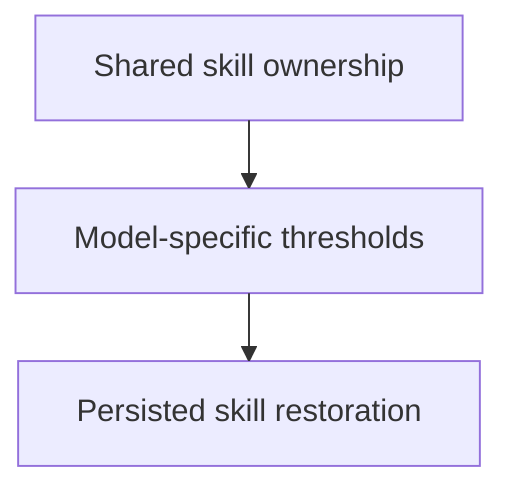

# Delivery Plan: Skill restoration after compaction

Deliver the approved design in three independently verifiable units. The user authorized planning, implementation, and local commits with final_only acceptance.

## Key definitions and abbreviations

Terms follow `terms.md`. Unit identifiers describe delivery order.

## Delivery Strategy

See `technical-solution.md`, Configuration, rendering, and loading. Each completed unit receives a local commit; nothing is pushed.

## Main Changes

Share skill ownership logic, align threshold inputs with model overrides, and deliver persisted skill restoration through the package lifecycle.

## Entities and Invariants

See `technical-solution.md`, Persistent restoration and request insertion, Effective selection and ownership, and Content and budget.

## New Folders and Components

See `solution.md`, Extension and configuration and Shared skill path rule.

## Backward Compatibility

No additional backward-compatibility mechanism. Existing unrelated behavior is preserved.

## Plan Units

### Unit Tree

### Decomposition Justification

Each unit has OWN VERIFICATION at IN PROCESS level through its public entry point. Unit 3 also has RUN checks for real package and child loading. No temporary production entry point is introduced. All units run sequentially because package checks share a working tree; Unit 3 also depends on the first two units' helpers.

## Overengineering and Overspecification Considerations

Each unit implements an approved design element. No separate test infrastructure, compatibility layer, retry, or speculative configuration unit is added. Module names and implementation details remain the implementer's responsibility.

### Unit UNT-01 - SLICE: Preserve skill read ownership

Status: done, commit `69a351c`. RED/GREEN boundary test and all three reviews passed. Final checks: 1,841 Bun tests passed, 1 skipped; Go tests, typecheck, and check passed.

#### Goal

Context projection recognizes every descendant of a listed skill directory under the shared ownership rule, including leading-two-dot filenames.

#### Behavior

When context projection encounters a successful skill read, it preserves its contents according to the listed directory boundary. Relative, home-prefixed, and @-prefixed inputs resolve consistently.

#### Work

SubAgentCoderSimple extracts the existing path logic from `pi-package/shared/context-projection.ts` into the shared skill-path module specified by the solution. The existing context-projection tests and adjacent helper tests establish path ownership. No additional ownership policy is added.

#### Verification

OWN VERIFICATION, IN PROCESS. A new failing boundary test establishes RED; the shared helper and projection entry point establish GREEN. Run `bun run test`, `bun run typecheck`, and `bun run check` before completion.

#### Exit criteria

Required path forms, leading-two-dot descendants, and parent/sibling exclusion pass. Existing projection behavior passes. SubAgentCodeQuality, SubAgentTextQuality, and SubAgentAnalyst each check this unit's complete behavior. Main agent reads the diff, accepts corrections, and creates its local commit.

#### Relation

INDEPENDENT logically; scheduled before UNT-02 and UNT-03 to avoid shared working-tree conflicts. UNT-03 depends on its shared rule.

#### Risks

MEDIUM: extraction changes resolution or protection. Existing path-form and projection tests plus the new boundary test cover this risk.

### Unit UNT-02 - SLICE: Apply model-specific compaction limits

Status: done, commit `a2df9dc`. Helper and caller RED/GREEN tests and all three reviews passed. Final checks: 1,849 Bun tests passed, 1 skipped; Go tests, typecheck, and check passed.

#### Goal

Compaction-trigger and footer use the reserve-token value Pi applies to the selected model, and restoration can obtain the matching recent-work headroom.

#### Behavior

When a model-specific override exists, settings resolution and its callers use that override. Ordinary values and defaults remain effective when no override applies.

#### Work

SubAgentCoderRegular updates the shared native compaction settings contract and migrates its compaction-trigger and footer callers. Relevant sources are `pi-package/shared/native-compaction-settings.ts`, `pi-package/extensions/compaction-trigger/index.ts`, `pi-package/extensions/footer/index.ts`, their tests, and their existing extension documentation. Comparison semantics remain unchanged.

#### Verification

OWN VERIFICATION, IN PROCESS. New failing model-override and keep-recent tests establish RED. Caller tests verify observable threshold/footer results. Run all three package checks.

#### Exit criteria

Selected-model, ordinary, default, enabled/disabled, and invalid settings cases pass. Callers use the selected model and preserve existing comparison behavior. SubAgentCodeQuality, SubAgentTextQuality, and SubAgentAnalyst check the complete unit. Main agent reads the diff, accepts corrections, and creates its local commit.

#### Relation

Sequential after UNT-01 for working-tree isolation. UNT-03 depends on this contract.

#### Risks

MEDIUM: settings shape or overrides alter threshold behavior. In-process caller tests and existing full-suite checks cover this risk.

### Unit UNT-03 - SLICE: Restore skills after compaction

Status: done, implementation commit `8e113b8`. D9 path-only persistence and per-request disk reads are implemented. CodeQuality, TextQuality, and Analyst accepted the settled unit. Final main-agent verification: 1,882 Bun tests passed, 1 existing skip; Go tests, strict TypeScript, formatting, and lint passed. The earlier content-bearing draft and proposed D8 were superseded before any feature commit.

#### Goal

Deliver FRQ-01 through FRQ-04 across compaction, request insertion, path-only persistence, budget, and package loading.

#### Behavior

After successful compaction, each subsequent request receives current disk contents of the branch-associated files that fit and the absent-file list. The session stores only tracked paths. Repeated compaction, session reopening, context edits, retained suffixes, changing file contents and request budgets, model limits, and child loading follow the D9 design.

#### Work

SubAgentCoderRegular implements the separate extension, its isolated tests, enabled-only configuration, path-record rendering with in-memory delivery metadata, package registration/order tests, and extension documentation. It uses UNT-01 and UNT-02 helpers with existing context mapping and request estimation. Persisted restoration data contains paths only. Each context event reads disk and packs against its actual runtime prompt, tools, and messages; no content cache, snapshots, or fit-decision entries are introduced. Integration sources include custom-compaction, context-projection, compaction-trigger, system-prompt, and existing real Pi loading fixtures. The system-prompt prose change is verified by review, never by prompt-content assertions.

#### Verification

OWN VERIFICATION, IN PROCESS plus RUN. RED tests cover effective successful loads, independently observable replaced/omitted loads, skill commands, ownership, retained exclusions, prior path priority, repeat compaction, same-summary IDs, reopen/tree replay, malformed path records, configuration, full/partial/zero and boundary budgets, current disk reads after file changes and deletion/reappearance, changing runtime prompt/model budgets, and deterministic single-copy insertion. A behavior check proves path-only persistence without assertions about prompt wording. Real Pi checks prove single registration and main/child loading with temporary state and a debug extension. Run all three package checks.

#### Exit criteria

All FRQs have behavior evidence. Tests assert logic and structured data only. Temporary state is removed. SubAgentCodeQuality, SubAgentTextQuality, and SubAgentAnalyst check the complete behavior. Main agent reads every change, verifies runtime evidence and the full suite, and creates the unit's local commit.

#### Relation

DEPENDENT on UNT-01 and UNT-02. No concurrent implementation.

#### Risks

HIGH: a misplaced or oversized insertion violates the restoration goal. Effective-context tests, real Pi compaction/loading checks, actual package runtime-prompt coverage, and complete-request budget assertions cover this risk. Model compliance with absent-file instructions remains external behavior.

## Test Strategy

Bun behavior tests use isolated temporary fixtures and fake external services/providers. Public Pi session projection can be exercised in process. Real CLI checks isolate package discovery, cwd, and state, and inspect runtime data. No test checks prompt content. Validation processes started by subagents omit PI_SUBAGENT_* from their child environment without changing session variables or HOME.

## Dependencies and Resourcing

No dependency change. Three sequential coder assignments. For each unit, SubAgentCodeQuality checks and corrects first, SubAgentTextQuality checks and corrects next, and SubAgentAnalyst reviews the corrected result last. Each reviewer receives the settled diff from the preceding check. Reviews do not overlap.

## Project Definition of Done

FRQ evidence, current extension documentation, strict type checks, full behavior suite, formatting/lint checks, real Pi loading evidence, local unit commits, and final acceptance report. No push.

## Assumptions

Provider cache hits and model compliance are external effects, as documented in the approved solution.

## Open Questions

None.

## Standards Deviations

None.

## References

- `target-picture.md`
- `requirements.md`
- `technical-solution.md`
- `decisions.md`
- `project-state.md`
