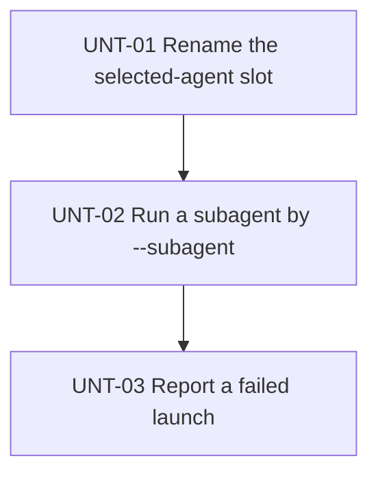

# Delivery Plan: Launch of a subagent from the command line

Implement [solution.md](solution.md) in three sequential units: a rename of the selected-agent slot, the launch of a subagent by `--subagent`, and the error of a failed launch.

## Key definitions and abbreviations
- Terms of the feature are in [terms.md](terms.md).
- Prompt dump: the system prompt and active tools that a temporary debug extension writes from `before_agent_start.systemPrompt` and `pi.getActiveTools()` in a real Pi run, by rule 5 of "Validation rules" in `AGENTS.md`. As in [implementation-checks.md](../system-prompt-agent-type/implementation-checks.md), the run uses temporary state, a fixture provider that throws if called, and a final debug handler that ends the process before a model request.

## Delivery Strategy
Follow [solution.md](solution.md). No release, push, migration, or configuration parameter is included.

## Main Changes
The selected-agent slot of `agent-runtime-composition` gets names for any agent of the session. run-subagent gets flag `--subagent`, applies the named subagent definition, and reports a failed launch. main-agent-selection and system-prompt read the launch request through `agent-runtime-composition`.

## Entities and Invariants
Follow [solution.md](solution.md), sections "Exchange of launch requests between extensions", "Application of the subagent definition", "Agent role", and "Delegation depth".

## New Folders and Components
No new folders or extensions. The two resolvers of launch requests are new members of `agent-runtime-composition`.

## Backward Compatibility
NRQ-01 of [prd.md](prd.md): processes without `--subagent` keep their behavior. The rename keeps no old names, because only the package uses the slot.

## Plan Units

### Unit Tree

### Decomposition Justification
- UNT-01: `EXISTING TESTS`. The tests of `agent-runtime-composition`, main-agent-selection, run-subagent, system-prompt, workflow, usage, footer, and toolsets cover each reader of the slot. The unit adds no logic or test only to make itself testable.
- UNT-02: `OWN VERIFICATION` at level `IN PROCESS` through the `session_start` and `before_agent_start` handlers of the extensions, and at level `RUN` through a real Pi run with `--subagent`. The unit needs no code of UNT-03: a launch with a valid definition does not reach the error path.
- UNT-03: `OWN VERIFICATION` at levels `IN PROCESS` and `RUN`. It depends on UNT-02, because the error path belongs to flag `--subagent`.

## Overengineering and Overspecification Considerations
- Each unit implements a part of [solution.md](solution.md): UNT-01 its section "Rename of the slot", UNT-02 FRQ-01, FRQ-02, FRQ-03 without its error, and FRQ-05, UNT-03 FRQ-04 and the error of FRQ-03.
- Prompt dumps before and after the change are the verification method of NRQ-01.
- No other element goes beyond [solution.md](solution.md).
- The implementer decides the new names of the slot members and the resolvers, the layout of tests, and the text of error messages.

### Unit UNT-01 - PREFACTORING: Rename the selected-agent slot

#### Goal
The slot of `agent-runtime-composition` and its types have names for the selected agent of the session, and the package behaves as before.

#### Work
- Before the first change, the implementer makes prompt dumps of a main agent selected by `--agent` and of a subagent that this main agent starts through run-subagent. These dumps are the baseline of NRQ-01.
- Rename in `pi-package/shared/agent-runtime-composition.ts` the members and types of the slot: `setMainAgentContribution`, `getMainAgentContribution`, `clearMainAgentContribution`, `MainAgentContribution`, and `MainAgentRuntimeInfo`, with the private field, the change event, and the parameters named `mainAgent` in their readers.
- Readers in production code: `readFooterRenderState` of footer; `applyAgentSelection`, `handleSessionStart`, `captureSessionReplacementMainAgent`, and `promptForAgent` of main-agent-selection; `publishPromptContribution`, `resolveEffectiveCallableAgentPolicy`, `filterSubagentTools`, and `createRootCoordinator` of run-subagent; `resolveMainAgentId` of usage; `createWorkflowPolicyReader`, `synchronizeWorkflowModelRuntime`, and `commitWorkflowStateChange` of workflow.
- Readers in tests: the tests of these extensions and of system-prompt, `pi-package/shared/agent-runtime-composition.test.ts`, `test/shared/agent-runtime-composition.test.ts`, `pi-package/shared/toolsets/runtime.test.ts`, `test/extensions/footer/index.test.ts`, and `test/fixtures/workflow-agent-selection.ts`.
- Boundaries: names that belong to main-agent selection itself stay, for example `loadSelectableAgents`. Runtime diagnostics keep their event names and fields unless their text names the slot.

#### Verification
`EXISTING TESTS`: `bun run verify`. Prompt dumps of the two baseline runs match the baseline.

#### Exit criteria
- No production code or test of the package references the old names.
- `bun run verify` passes.
- The prompt dumps match the baseline.
- The change passes `gate-code` and `gate-overengineering`.

#### Relation
UNT-02 depends on it.

#### Risks
- `LOW`: a reader of the slot outside the listed files keeps an old name. The type check fails on it, so `bun run verify` finds it.

### Unit UNT-02 - SLICE: Run a subagent by --subagent

#### Goal
An external launcher runs a subagent definition by `pi --subagent <id>`, and the agent works by this definition with the child-agent role.

#### Behavior
An external launcher starts `pi --subagent <id>` for a definition with `type: subagent` or `type: both` and sends a task. The agent gets the prompt, model, thinking level, tools, allowed workflows, and callable subagents of the definition, gets the child-agent sections of the system prompt template, and has delegation depth 1. The saved main agent and the selection commands of main-agent-selection change nothing in this process.

#### Work
- run-subagent: `pi-package/extensions/run-subagent/index.ts` registers the flag and applies the definition in `session_start`; `agent-policy.ts` provides the model and thinking resolution that `resolveLaunchConfiguration` uses; `entry-config.ts` gives depth 1 to the process.
- `pi-package/shared/agent-runtime-composition.ts`: the resolver of `--subagent`.
- main-agent-selection: `pi-package/extensions/main-agent-selection/index.ts` skips restoration, `--agent`, `/agent`, its shortcut, and the pending selection when the resolver reports a launched subagent.
- system-prompt: `pi-package/extensions/system-prompt/index.ts` and `environment.ts` choose the role in `before_agent_start`.
- Tests next to each changed module, by RED-GREEN-REFACTOR, without checks of prompt content (rule 5 of "Testing rules" in `AGENTS.md`).
- Documentation: `docs/extensions/run-subagent.md` (flag `--subagent` and the depth), `docs/extensions/main-agent-selection.md` (behavior with a launched subagent), and `docs/extensions/system-prompt.md` (the role rule in "Role sections").

#### Verification
`OWN VERIFICATION`, level `IN PROCESS`: tests of the handlers of run-subagent, main-agent-selection, and system-prompt. Level `RUN`: a prompt dump of `pi --subagent <id>` for a test definition with tools, workflows, and callable subagents shows the prompt of the definition, the child-agent sections, the tools of the definition, and subagent tools with run-subagent `maxDepth` 2 and without them with `maxDepth` 1.

#### Exit criteria
- The `IN PROCESS` tests and the `RUN` check pass.
- `bun run verify` passes, and the prompt dumps of the two baseline runs match the baseline of UNT-01.
- The three documents describe the behavior.
- The change passes `gate-code`, `gate-overengineering`, and, for the documents, `gate-document`.

#### Relation
Depends on UNT-01. UNT-03 depends on it.

#### Risks
- `MEDIUM`: the model of the definition is not active before the first task, because main-agent-selection applies a model differently from the resolution that run-subagent uses for a child. The `RUN` check shows the model of the session, and the implementer applies the model through the same path as main-agent-selection.

### Unit UNT-03 - SLICE: Report a failed launch

#### Goal
When Pi cannot apply the agent named by `--subagent`, the external launcher gets the reason before the agent handles any task.

#### Behavior
An external launcher starts `pi --subagent <id>` with an ID that Pi cannot apply, or with `--agent` in the same command, and sends a task. Pi writes the reason to stderr, runs no agent on the task, and ends the process.

#### Work
- run-subagent: `pi-package/extensions/run-subagent/index.ts` holds input until the definition is applied and handles a failed application.
- `pi-package/shared/agent-runtime-composition.ts`: the resolver of `--agent`, which main-agent-selection registers in `pi-package/extensions/main-agent-selection/index.ts`.
- QST-01 of [solution.md](solution.md): the implementer runs real Pi in RPC and print modes with an unknown ID and records the exit code. If the code is 0, the implementer sets a nonzero code.
- Tests next to the changed modules, by RED-GREEN-REFACTOR.
- Documentation: the errors of `--subagent` in `docs/extensions/run-subagent.md`.

#### Verification
`OWN VERIFICATION`, level `IN PROCESS`: tests of the `session_start` and `input` handlers of run-subagent for each reason from section "Failure of the launch" of [solution.md](solution.md). Level `RUN`: real Pi in RPC and print modes with an unknown ID, with a definition of `type: main`, and with `--agent` and `--subagent` together; each run ends with the reason on stderr and a nonzero exit code, and no model request happens.

#### Exit criteria
- The `IN PROCESS` tests and the `RUN` checks pass.
- `bun run verify` passes, and the prompt dumps of the two baseline runs match the baseline of UNT-01.
- `docs/extensions/run-subagent.md` describes the errors.
- The change passes `gate-code`, `gate-overengineering`, and, for the document, `gate-document`.

#### Relation
Depends on UNT-02.

#### Risks
- `MEDIUM`: in RPC mode, `ctx.shutdown()` waits for the launcher, so the process does not end. The `RUN` check of QST-01 shows it before the unit is complete, and the solution then needs a change by its owner.

## Test Strategy
- Unit tests of the handlers of the changed extensions with fake Pi APIs, as the existing tests of these extensions do.
- Real Pi runs with prompt dumps for NRQ-01 and for the `RUN` checks of UNT-02 and UNT-03, with temporary state and test definitions outside the configuration of the user.
- No test checks prompt content.

## Dependencies and Resourcing
- No model provider: the fixture provider of the prompt dumps serves each model of the test definitions.
- Dependency versions that the lockfile already declares.

## Project Definition of Done
- FRQ-01–FRQ-05 and NRQ-01 of [prd.md](prd.md) hold.
- `docs/extensions/run-subagent.md`, `docs/extensions/main-agent-selection.md`, and `docs/extensions/system-prompt.md` describe the new behavior.

## Assumptions
- A real Pi run with a debug extension can dump the prompt of a process with `--subagent`, as it does for main agents and subagents. The `RUN` check of UNT-02 verifies it.

## Open Questions
QST-01 of [solution.md](solution.md), resolved in UNT-03.

## Standards Deviations
No deviations.

## References
- [solution.md](solution.md) - technical solution.
- [prd.md](prd.md) - requirements.
- `AGENTS.md` - testing and validation rules of the project.
