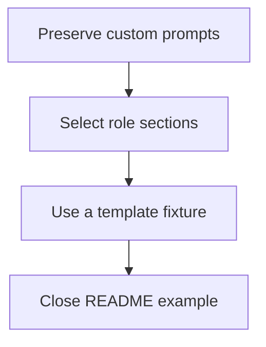

# Delivery Plan: System prompt by kind of agent session

Implement the approved solution in two sequential behavior slices, followed by the user's requested F2 and F3 corrections. The verification policy is `final_only`; O4-1 authorizes the original implementation, and the user's request to fix F2 and F3 authorizes the two follow-up units.

## Key definitions and abbreviations
Use [terms.md](terms.md). A slice delivers one observable behavior through the extension entry point, its documentation, and its tests.

## Delivery Strategy
Follow `technical-solution.md`, Custom prompts and tools, then Template representation and session kind. No release, push, migration, or new configuration flag is included. Download only the dependency versions already declared by the rebased lockfile before validation.

## Main Changes
Preserve Pi's custom prompts, then render role-specific template sections and apply the approved bundled rules.

## Entities and Invariants
Follow `technical-solution.md`, Template representation and session kind and Template boundary validation. Preserve the visible active-tool guideline formatter received from `main`, active-tool reconciliation, and runtime prompt contributions.

## New Folders and Components
Follow `technical-solution.md`, Template representation and session kind. The implementer may use small extension-local modules for section handling and process-environment access. No new package or general template engine is planned.

## Backward Compatibility
NRQ-01 and NRQ-02 retain bundled main-agent text except the approved defect rule and retain custom-template rendering without markers. The invalid-template behavior and section syntax are the confirmed design, not a new compatibility decision.

## Plan Units

### Unit Tree

### Decomposition Justification
The two feature slices can each be verified through the registered `session_start` and `before_agent_start` handlers. Real Pi runs check CLI and child-process wiring beyond fixture coverage. Neither slice needs a temporary production entry point or code from the following unit to pass. The F2 follow-up has independent test-suite verification; the F3 document follow-up has independent Markdown-parser verification. Execute units sequentially to keep source and validation state stable.

## Overengineering and Overspecification Considerations
The two slices correspond to FRQ-05/06 and FRQ-01/02/03/04 plus NRQ-01/02. Fixture tests cover their own observable behavior; no bundled prompt-content test is added. There is no unrelated refactoring, dependency change, fallback, or future-facing configuration. Parser mechanics and fixture layout remain implementation choices.

### Unit UNT-01 - SLICE: Preserve custom prompts

#### Goal
A session with a custom prompt retains Pi's prompt while runtime composition continues to apply tool policy and prompt contributions.

#### Behavior
After session initialization, the `before_agent_start` handler preserves the incoming prompt when Pi supplies a truthy custom prompt. The handler applies this condition with bundled and custom templates. Custom-prompt sources are CLI `--system-prompt` text or files, a trusted project's `.pi/SYSTEM.md`, and the Pi agent directory's `SYSTEM.md`, including council participant CLI prompts. Sessions without a custom prompt retain template rendering.

#### Work
SubAgentCoderRegular implements FRQ-05 and its part of FRQ-06 with RED-GREEN-REFACTOR. Sources include `pi-package/extensions/system-prompt/index.ts`, its colocated tests, `pi-package/shared/agent-runtime-composition.ts`, `docs/extensions/system-prompt.md`, and the README extension row. Scope includes the handler, fixture behavior tests, and documentation of the custom-prompt exception. Runtime composition and dependency declarations remain unchanged. Include the task's confirmed research documents in this unit's local commit.

SubAgentCodeQuality checks the complete changed code path and tests. SubAgentTextQuality checks changed documentation and comments. SubAgentAnalyst checks behavior from entry point through reconciliation and prompt contributions. The main agent accepts their results and runs the project checks in a normal execution environment.

#### Verification
Independent in-process verification: failing-first fixture tests cover prompt preservation with both template sources, active-tool reconciliation, selected-agent contributions, and Pi-compatible empty-string behavior. Runtime verification: repeat CLI, trusted-project `.pi/SYSTEM.md`, agent-directory `SYSTEM.md`, and actual council-child probes with prompt and active-tool dumps before any provider request.

#### Exit criteria
The tests fail before the implementation and pass afterward. Full `bun run test`, `bun run typecheck`, and `bun run check` pass with declared dependency versions. All three reviews have no unresolved in-scope findings. Runtime dumps show custom prompts retained and the expected active tools. No temporary debug code is in the diff. Code, document, and overengineering gates pass. Record the results and create one local commit.

#### Relation
Independent of UNT-02 implementation output. UNT-01 precedes UNT-02 because both modify the same entry point and documentation.

#### Risks
Skipping too early could bypass reconciliation. Fixture tests and runtime active-tool dumps verify preservation. Inherited collector markers can cause false test failures. Follow D9: omit `PI_SUBAGENT_*` and `PI_AGENT_SUITE_CHILD_AGENT_PROCESS` from a copied check-subprocess environment while preserving the parent environment and HOME.

### Unit UNT-02 - SLICE: Render sections for the process role

#### Goal
The extension renders each session's applicable template parts and supplies the approved bundled role rules.

#### Behavior
For a session without a custom prompt, template rendering includes common parts and the selected role's sections. Malformed role sections use the invalid-template path and preserve Pi's prompt. Marker-only lines disappear with their line breaks; section-free templates retain their bytes.

#### Work
SubAgentCoderRegular implements section parsing, shared-marker classification through the existing environment pattern, bundled rule placement, fixture behavior tests, and documentation. Sources include `pi-package/extensions/system-prompt/index.ts`, its tests and bundled template, `pi-package/shared/child-agent-environment.ts`, extension-local environment patterns, and `docs/extensions/system-prompt.md`. Preserve the exact approved wording in `prd.md` and preserve all other bundled text. Do not add generalized template syntax or configuration.

SubAgentCodeQuality checks code and tests, SubAgentTextQuality checks changed docs/comments and the approved wording, and SubAgentAnalyst checks complete role-selection and validation paths. The main agent accepts results and validates the slice.

#### Verification
Independent in-process verification: fixture templates cover common, main-agent, and child-agent selection; repeated and inline sections; marker-only LF and CRLF lines; ordinary variables; section-free compatibility; and unmatched, mismatched, nested, and unknown-kind markers. Selection precedes variable substitution. Runtime verification: check single-extension and whole-package loading, main and child sessions, and custom-prompt preservation. Perform the one-time NRQ-01 byte comparison against the Git baseline with only the approved rule substitution; do not commit a bundled prompt-content test.

#### Exit criteria
RED-GREEN evidence, complete project scripts, all three reviews, runtime prompt/tool checks, and the one-time byte comparison pass. No temporary debug code is in the diff. Code, document, and overengineering gates pass. Record results and create one local commit.

#### Relation
Depends on UNT-01. Concurrent implementation would modify the same files, so start only after UNT-01 is ready and committed.

#### Risks
Whitespace trimming could alter bundled output; exact fixture line-ending checks and the one-time comparison verify this. User templates are external input; validate markers once at load and retain ordinary-variable behavior.

### Unit UNT-03 - OTHER TASK: Replace bundled-content assertions with fixture logic

#### Goal
Resolve F2 without changing production behavior or reducing renderer verification.

#### Work
SubAgentCoderSimple replaces the existing bundled-layout test in `pi-package/extensions/system-prompt/index.test.ts` with an isolated synthetic-template check of dynamic toolset insertion at fixture-defined positions. Use the existing test helpers and runtime fake. Remove assertions tied to bundled-template tags and update the test name/comments. Do not change production code, bundled content, neighboring tests, or dependencies.

SubAgentCodeQuality checks and corrects the test change, SubAgentTextQuality checks its name/comments, and SubAgentAnalyst reviews it against the approved F2 correction. Follow the workflow's sequential review order.

#### Verification
Run the existing focused suite before and after the fixture-only refactor. This is test maintenance with no production behavior change, so no artificial failing-first production change is required. Verify the new assertion against fixture-defined substitution output. Full root test, typecheck, and check scripts must pass under D9.

#### Exit criteria
The replacement reads only isolated fixture input and checks rendering logic. The focused suite and root scripts pass, all three reviews have no unresolved in-scope finding, and the unit has a local commit. No new dependency or prompt-content assertion is introduced.

#### Relation
Follows completed UNT-02. It is logically independent of UNT-04, but runs first so validation and review use a stable test file.

#### Risks
A weaker replacement could lose insertion-order verification. Use fixture-defined surrounding text and exact dynamic output, rather than checking bundled prose or markup.

### Unit UNT-04 - DOCUMENT: Close the README configuration example

#### Goal
Resolve F3 by displaying separate minimum and full context-projection configuration examples.

#### Behavior
When a reader views the README, the full-example label is ordinary text and each JSON example has its own fenced code block.

#### Work
SubAgentCoderSimple adds the missing closing fence in the context-projection minimum example in `README.md`. Preserve both JSON objects and all other README content. SubAgentCodeQuality checks the technical-syntax change, SubAgentTextQuality checks the example boundaries, and SubAgentAnalyst checks the correction against F3. Follow the workflow's sequential review order.

#### Verification
Use the already installed Markdown parser to inspect the affected excerpt before and after the change. Before the fix, the full-example label is part of the minimum code block. After the fix, the parser produces the full-example paragraph followed by a JSON code block, and both code blocks parse as JSON. Run `git diff --check`. No permanent README-content test, new package, or production-code check is needed for this document-only unit.

#### Exit criteria
The existing parser confirms separate example blocks, both JSON objects retain their original content, all three reviews have no unresolved in-scope finding, and the unit has a local commit.

#### Relation
Runs after UNT-03 for stable sequential validation. It requires no production code from UNT-03.

#### Risks
Adding the fence at the wrong boundary could alter another example. Inspect only the named example and compare the complete README diff.

## Test Strategy
Use Bun fixture tests through the extension handlers. Add integration tests only if unit tests cannot prove package loading, single registration, or child Pi behavior. Real Pi checks use temporary cwd/state and debug extensions, inspect the final before-agent-start prompt and active tools, and terminate before any provider request. No prompt is passed in offline mode. Tests verify logic, never bundled prompt content.

## Dependencies and Resourcing
UNT-01 and UNT-02 use SubAgentCoderRegular. UNT-03 and UNT-04 use SubAgentCoderSimple for the approved local corrections. Every unit receives SubAgentCodeQuality, SubAgentTextQuality, and SubAgentAnalyst checks in the workflow's required order. No new dependencies are required.

## Project Definition of Done
Both feature slices and the two authorized follow-up corrections are committed locally. Project scripts pass; extension docs describe the implemented behavior; runtime checks and NRQ-01 comparison pass; the README example parser check passes; temporary runtime state is removed; the user receives an acceptance report. No push occurs.

## Assumptions
No unresolved implementation assumption. Real Pi routing observations were collected before the checkpoint.

## Open Questions
None.

## Standards Deviations
None.

## Unit status
| Unit | Status | Commit |
| --- | --- | --- |
| UNT-01 | Done | `4a37e4b` |
| UNT-02 | Done | `1a4aeed` |
| UNT-03 | Ready; fixture correction and all reviews passed | Recorded after commit |
| UNT-04 | Planned | Pending |

## References
- [technical-solution.md](technical-solution.md)
- [requirements.md](requirements.md)
- [decisions.md](decisions.md)
- [project-state.md](project-state.md)
