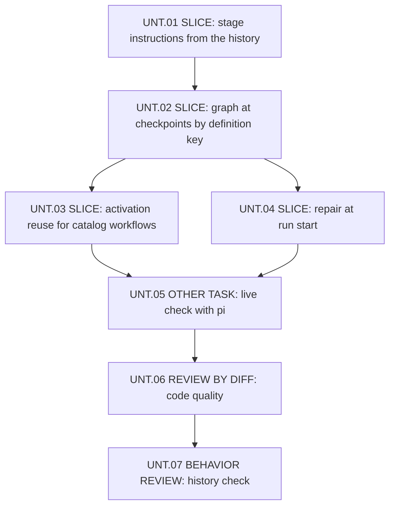

# Delivery Plan: Workflow records checked against the session history

The plan delivers two approved technical solutions that share one history check: [Reuse workflow rules and graph on repeated activation](solution.md) and [Workflow records dropped before delivery](../workflow-discarded-record-reuse/solution.md). Below, "solution A" names the first document and "solution B" the second.

## Key definitions and abbreviations

- Counted record: a workflow record that meets the three conditions of SOL-02 of solution A: Pi saved it, the model receives its messages, and the received text equals the saved text.
- Definition key: the key of SOL-01 of solution A, computed from the workflow ID, the root guidance, and the rendered graph.

## Delivery Strategy

One branch and one release, without a feature flag or a data migration. Records that earlier versions saved keep their format; solution A, section "Trade-offs", describes how they count.

## Main Changes

- `WorkflowJournal` decides stage instruction reuse, graph inclusion, and activation reuse from counted records instead of its memory: solution B SOL-01, solution A SOL-02 and SOL-04.
- Activation of a catalog workflow refers to visible rules and graph instead of repeating them: solution A SOL-03.
- Each run starts with a checkpoint when the session does not show the current workflow state: solution B SOL-02.

## Entities and Invariants

See solution A, SOL-01 and SOL-02, and solution B, SOL-01 and SOL-02.

## New Folders and Components

No new folders or components.

## Backward Compatibility

Sessions saved by earlier versions keep working. Their records carry no definition key and do not count as a known definition, as the user decided; solution A, section "Trade-offs", lists the one-time copies that follow.

## Plan Units

### Unit Tree

UNT.03 and UNT.04 change `context.ts` and `index.ts` together, so they run one after the other in one working copy, in either order.

### Decomposition Justification

- UNT.01: its own entry points verify it: a stage entry, an activation, a nested exit, and a checkpoint after a dropped record. It brings the counted-record check as the shared part that the later units use, so it needs no separate change of structure.
- UNT.02: its own entry points verify it: `session_compact` and session start with an older visible definition. It adds definition keys to the records that show a graph; a test reads them through the checkpoint decision.
- UNT.03: its own entry point verifies it: `workflow_activate` twice for one catalog workflow, and the same for a workflow from `workflow_create`.
- UNT.04: its own entry point verifies it: the `before_agent_start` handler after a dropped activation.
- No unit needs logic or tests that exist only to make it testable.

## Overengineering and Overspecification Considerations

- Each element of the plan comes from an approved solution; the plan adds no method.
- UNT.05 is the live check that rule 5 of section "Validation rules" of `AGENTS.md` requires for changed agent context.
- UNT.06 and UNT.07 are the reviews that the rules of work require for changed code.
- Left to the implementer: names of functions, metadata fields, and the reuse attribute value, the hash function, and how the publication paths receive projected entries.

### Unit UNT.01 - SLICE: Stage instructions from the history

#### Goal

The extension sends a reuse entry only when a counted record shows the instructions of the same stage definition (solution B SOL-01).

#### Behavior

After Pi drops a record with stage instructions, the next record of this stage holds the instructions again. While a counted record shows them, the next entry into the stage stays a reuse entry, as now.

#### Work

- Add the counted-record check over the entries of `buildSessionProjection()`, as SOL-02 of solution A defines it.
- `WorkflowJournal.activate`, `enterStage`, `checkpoint`, and `updateStage` in `pi-package/extensions/workflow/context.ts` decide stage reuse from counted records with the stage key, also for the stage keys of waiting workflows.
- Remove the set of known stages and its rebuild in `WorkflowJournal.restore`; keep the other restored fields.
- Pass projected entries from the call sites in `pi-package/extensions/workflow/index.ts`.
- Update section "Provider context" of `docs/extensions/workflow.md` and add an entry under `## [Unreleased]` of `pi-package/CHANGELOG.md`.

#### Verification

In process: tests through the journal and the tool entry points with a real in-memory `SessionManager` projection. Cases: a dropped stage record, a kept stage record, a record removed by compaction, a waiting workflow in a checkpoint, and a session saved by an earlier version.

#### Exit criteria

The tests of the cases pass; `bun run verify` passes; no temporary code remains; the change passed workflow `QualityCheck`.

#### Relation

First unit; UNT.02 and UNT.04 depend on its counted-record check.

#### Risks

- A missed call site keeps the old memory-based decision. Impact MEDIUM. Mitigation: removal of the set of known stages makes each remaining use fail to compile.

### Unit UNT.02 - SLICE: Graph at checkpoints by definition key

#### Goal

A checkpoint omits the rules and graph only when the latest counted graph record of the workflow ID has the key of the saved definition (solution A SOL-01, SOL-04).

#### Behavior

After a compaction or on session start, the checkpoint restores the current rules and graph when the session shows only an older version, no version, or a record without a key. When the latest counted record shows the current version, the checkpoint omits them, as now.

#### Work

- Compute the definition key and store it in the metadata of each record that shows rules and graph: full activations and checkpoints, also for waiting workflows.
- Replace the workflow ID rule of `hasVisibleWorkflowGraph` with the key rule over counted records.
- Update the tests of graph visibility in `pi-package/extensions/workflow/context.test.ts` and `index.test.ts`, section "Provider context" of `docs/extensions/workflow.md`, and the changelog entry.

#### Verification

In process: tests through `session_compact` and session start with a real in-memory projection. Cases: an older version kept and the current one dropped, the current version kept, a waiting workflow, and a record without a key.

#### Exit criteria

The tests of the cases pass; `bun run verify` passes; no temporary code remains; the change passed workflow `QualityCheck`.

#### Relation

Depends on UNT.01. UNT.03 and UNT.04 depend on it.

#### Risks

- Sessions saved by earlier versions get one extra copy of the graph at the first checkpoint. Impact LOW. Mitigation: accepted in solution A, section "Trade-offs".

### Unit UNT.03 - SLICE: Activation reuse for catalog workflows

#### Goal

A repeated activation of a catalog workflow refers to the visible rules and graph instead of repeating them (solution A SOL-02, SOL-03).

#### Behavior

When the agent activates a catalog workflow and the latest counted graph record of its workflow ID has the same key, the activation record holds the workflow ID, the source, and the reuse marker, then the initial stage and the chain. Otherwise, and for each workflow from `workflow_create`, the record holds the full rules and graph.

#### Work

- Choose the activation form in `WorkflowJournal.activate` and `renderWorkflowActivation` of `context.ts` from counted records, for catalog workflows only.
- Make reused activations carry no definition key, so that UNT.02's rule never counts them.
- Update the test "reuses known stage definitions in a later run of the same workflow" of `context.test.ts`, section "Provider context" of `docs/extensions/workflow.md`, and the changelog entry.

#### Verification

In process: tests through `workflow_activate` and a bound catalog start. Cases: a second activation with the first record kept, after a compaction that summarized it, after a dropped first record, after a catalog change, after a return to an earlier catalog version, an intervening workflow, and a workflow from `workflow_create`.

#### Exit criteria

The tests of the cases pass; `bun run verify` passes; no temporary code remains; the change passed workflow `QualityCheck`.

#### Relation

Depends on UNT.02. Changes `context.ts` and `index.ts` together with UNT.04, so the two units run one after the other.

#### Risks

- The agent ignores a reuse marker and acts without the rules. Impact HIGH. Mitigation: the marker follows the existing `guidelines="reuse"` convention; UNT.05 observes a live agent with a reused activation.

### Unit UNT.04 - SLICE: Repair at run start

#### Goal

Each run starts with a checkpoint when the session does not show the current workflow state (solution B SOL-02).

#### Behavior

After Pi drops a workflow record, the next run of the agent starts with a checkpoint that holds the current stage, its transitions, the chain, and the rules, graph, and stage instructions that the session lacks. When the session shows the current state, the run starts without such a record. After the last exit, a dropped exit record is restored the same way.

#### Work

- In the `before_agent_start` handler of `index.ts`, apply the decision of `createWorkflowSynchronizer` to the projection that the handler already reads, with counted records, and return the checkpoint next to the activation options.
- Update section "Provider context" of `docs/extensions/workflow.md` and the changelog entry.

#### Verification

In process: lifecycle tests through `before_agent_start`. Cases: a dropped activation, a dropped stage entry, a dropped exit, a switch of the selected main agent before the run, and an ordinary run without missing records.

#### Exit criteria

The tests of the cases pass; `bun run verify` passes; no temporary code remains; the change passed workflow `QualityCheck`.

#### Relation

Depends on UNT.01 and UNT.02. Changes `index.ts` together with UNT.03.

#### Risks

- The check returns a checkpoint on each run because of a wrong comparison. Impact MEDIUM: the context grows instead of shrinking. Mitigation: the case "ordinary run without missing records" and UNT.05.

### Unit UNT.05 - OTHER TASK: Live check with pi

#### Goal

The real `pi` CLI with this package shows the changed records as the solutions describe, per rule 5 of section "Validation rules" of `AGENTS.md`.

#### Work

Run `pi` with the package in a temporary working directory and session state. Ask the agent to activate one catalog workflow, exit it, and activate it again. Inspect the saved session file: the second activation record holds the reuse marker and no graph, and its initial stage and chain are present. Remove the temporary state afterwards.

#### Verification

The inspected session file shows the expected record kinds and metadata.

#### Exit criteria

The record check above holds; the temporary state is removed.

#### Relation

Depends on UNT.03 and UNT.04.

#### Risks

- The live check needs a real model response and costs tokens. Impact LOW.

### Unit UNT.06 - REVIEW BY DIFF: Code quality

#### Goal

Each change of UNT.01 to UNT.04 passes a check against the rules of development.

#### Work

Agent `workflows:code-quality` reads the changes of UNT.01 to UNT.04 in `pi-package/`, `test/`, and `docs/extensions/` and reports violations; the implementer fixes the accepted ones.

#### Verification

The review report lists no unresolved accepted finding.

#### Exit criteria

Each accepted finding is fixed, and `bun run verify` passes after the last fix.

#### Relation

Depends on UNT.05.

#### Risks

None beyond the time of a review round.

### Unit UNT.07 - BEHAVIOR REVIEW: History check

#### Goal

The shared history check behaves as both solutions describe on each changed path.

#### Work

Agent `SubAgentAnalyst` traces activation, stage entry, nested exit, checkpoints, and run start from their entry points to the records that the model receives, against both solutions.

#### Verification

The review report lists no unresolved accepted finding.

#### Exit criteria

Each accepted finding is fixed and passed the tests of its unit; `bun run verify` passes.

#### Relation

Depends on UNT.06.

#### Risks

- The review finds rare cases that the solutions already accept. Impact LOW. Mitigation: the review prompt lists the accepted limitations.

## Test Strategy

- Unit and in-process tests with Bun, next to the code: `context.test.ts` with a real in-memory `SessionManager` for record decisions, and `index.test.ts` for tool and lifecycle entry points. Tests check record kinds and metadata, never prompt content, per rule 5 of section "Testing rules" of `AGENTS.md`.
- A live check with the real `pi` CLI in UNT.05.
- `bun run verify` after each unit.

## Dependencies and Resourcing

- Installed Pi 1.5.0: `buildSessionProjection`, `before_agent_start` messages, and the queue behavior that the solutions describe.
- A model provider for UNT.05.

## Project Definition of Done

- Section "Provider context" of `docs/extensions/workflow.md` describes the new behavior.
- `pi-package/CHANGELOG.md` holds the entries under `## [Unreleased]`.
- `docs/specs/roadmap.md` no longer lists both issues after UNT.07, as the roadmap lists only unfinished work.

## Assumptions

No assumptions.

## Open Questions

None.

## Standards Deviations

None.

## References

- [Solution A](solution.md) - rules and graph on repeated activation
- [Solution B](../workflow-discarded-record-reuse/solution.md) - dropped records and repair at run start
- [PRD](prd.md) - approved requirements and critical scenarios
- `AGENTS.md` - testing and validation rules
